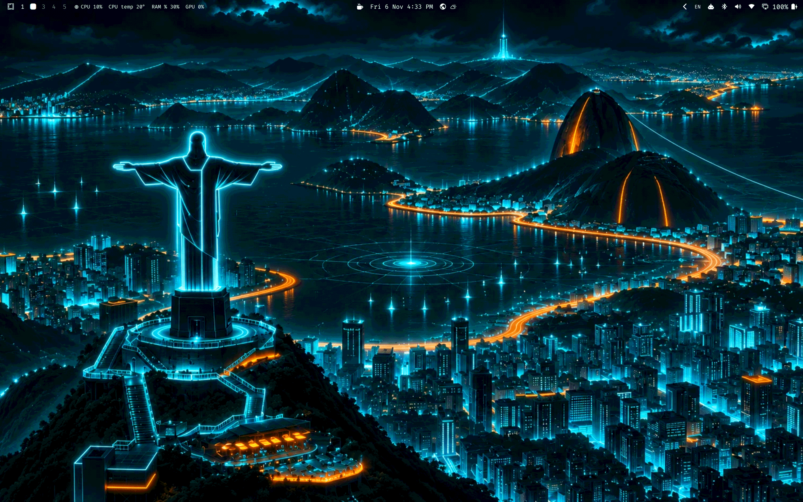
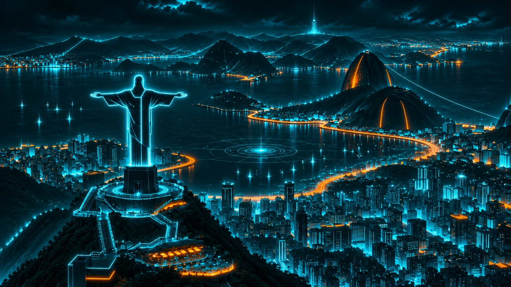
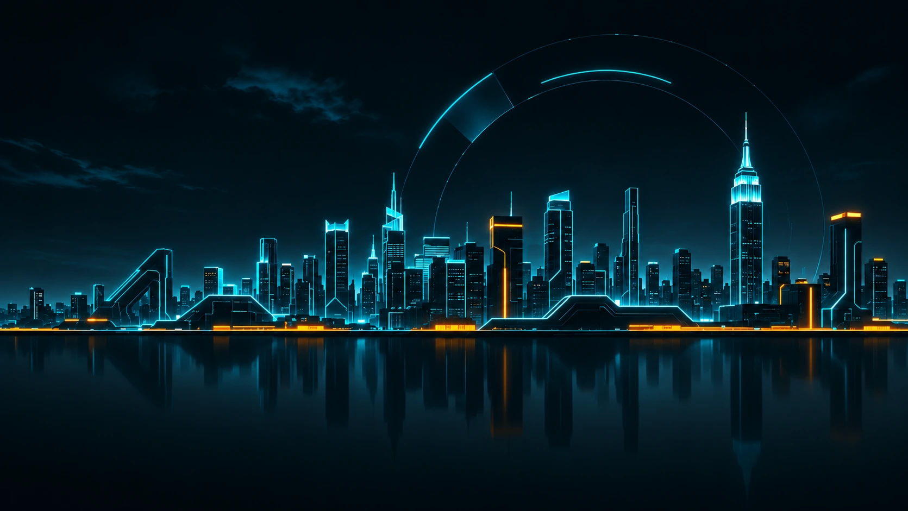

# TRON for Omarchy

**Digital Frontier.** A dark Omarchy theme inspired by TRON: Legacy. Black and navy surfaces, one electric cyan accent for what matters, orange only for alerts.

<p align="center">
  
</p>

## Install

```bash
omarchy theme install https://github.com/Murillofilho86/omarchy-tron-theme
```

Omarchy installs and applies **Tron**.

To apply it again later:

```bash
omarchy theme set Tron
```

Recommended font: JetBrainsMono Nerd Font, included with Omarchy.

## Palette

| Role | Name | Color |
| --- | --- | --- |
| Background | Void | `#03070d` |
| Cards, current line | Grid | `#0b1928` |
| Accent, focus, cursor | Electric | `#00e5ff` |
| Links, ANSI cyan | Cyan | `#00a9d6` |
| Borders at rest | Circuit | `#087ca7` |
| Selection, inactive border | Deep Blue | `#164b78` |
| Text | White | `#f0f8ff` |
| Secondary text | Silver | `#c5d9e8` |
| Comments, ANSI bright black | Muted | `#819aaf` |
| Disabled text | Disabled | `#526b82` |
| Alerts, ANSI orange | Orange | `#ff8a3d` |
| Errors, ANSI red | Red | `#ff5263` |
| Success, ANSI green | Green | `#43e6a2` |
| Warnings, ANSI yellow | Amber | `#ffd166` |

Omarchy needs a few colors the palette above does not define, so these were derived and checked at 5:1 or better on Void: blue `#4f9cf9`, magenta `#d06bff`, brown `#c27a4a`, and the bright variants of red, yellow, green, blue and magenta. Bright white is `#ffffff`.

### Contrast

WCAG 2.x contrast ratios. Text needs 4.5:1.

| Text | On Void | On Grid |
| --- | --- | --- |
| White | 18.82 | 16.53 |
| Silver | 13.91 | 12.22 |
| Muted | 6.90 | 6.06 |
| Electric | 13.13 | 11.53 |
| Weakest ANSI color (red on Void, brown on Grid) | 6.38 | 5.22 |
| Disabled | 3.64 | 3.20 |

White on the Deep Blue selection is 8.47 and Electric on it is 5.91. Disabled text is below 4.5 on purpose. The inactive window border is 2.22 on Void, because it is meant to stay discreet.

## What's included

- `colors.toml` drives the terminal, btop, Neovim, browser, Hyprland borders and the Omarchy shell.
- `shell.bar.toml`: nearly opaque Void bar, orange for modules that need attention.
- `shell.controls.toml`: circuit-blue borders at rest, electric cyan on focus and selection.
- `shell.lock.toml`: circuit-blue border at rest, electric cyan while typing, red on a wrong password.
- `icons.theme`: Yaru-blue folders.
- `keyboard.rgb`: electric cyan keyboard backlight.
- `backgrounds/`: the theme's wallpapers.

## Wallpapers

Both wallpapers are roughly 1672 × 941 and not native 4K. Click an image to open the full-resolution file. Cycle between them with `omarchy theme bg next`.

<table>
  <tr>
    <td width="50%" align="center"><a href="backgrounds/01-tron-rio-digital-frontier.webp"></a><br><b>Rio · Digital Frontier</b><br>Cyan geometry over a dark city, with orange light trails on the roads.</td>
    <td width="50%" align="center"><a href="backgrounds/02-tron-new-york-dark-water-reflections.webp"></a><br><b>New York · Dark Water Reflections</b><br>A quiet neon skyline over still water, with plenty of dark space for windows.</td>
  </tr>
</table>

Landscape displays work best. Fill mode on ultrawide, 16:10 or portrait displays may crop the edges.

The wallpapers were generated with ChatGPT (OpenAI image generation).

## License

[MIT licensed](LICENSE). TRON is a community theme, not affiliated with Omarchy, TRON or Disney.
